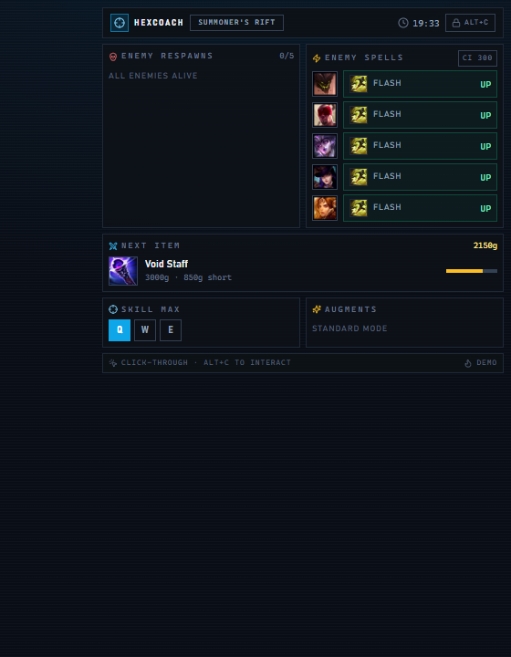

# HexCoach

A fast, lightweight League of Legends overlay coach built with **Tauri v2**, **Rust**, **React**, **TypeScript** and **Tailwind CSS**.

HexCoach reads the local Riot Live Client API and League Client API, then shows a compact always-on-top HUD with the things you actually need during a game: builds, runes, skill order, enemy threats, Arena augments and ARAM / ARAM Mayhem modifiers.

> HexCoach isn't endorsed by Riot Games and doesn't reflect the views or opinions of Riot Games or anyone officially involved in producing or managing Riot Games properties. Riot Games and all associated properties are trademarks or registered trademarks of Riot Games, Inc.

## Download

Every release ships a ready-to-install Windows MSI — no compiler or build tools required.

1. Open [Releases](https://github.com/adamhalvo123/hexcoach/releases/latest) and download `HexCoach_<version>_x64_en-US.msi`.
2. Run the MSI and follow the installer (per-user install, no admin prompt).
3. Launch **HexCoach** from the Start menu.

Windows SmartScreen may warn about an unsigned build — choose **More info** → **Run anyway**. Windows 11 already includes the WebView2 runtime; on Windows 10 the installer will prompt to fetch it if it is missing.

## Screenshots

| Live game | Draft helper |
| --- | --- |
|  |  |

| Builds & runes | Arena Lab |
| --- | --- |
|  |  |

| In-game HUD | Compact overlay |
| --- | --- |
|  |  |

| Settings |
| --- |
|  |

## Design

HexCoach ships three themes, switchable live in Settings and persisted locally:

- **Dark** (default) — deep navy-black surfaces (`#090d16`), layered panels (`#161b22`), slate type and cyan/gold accents.
- **Light** — cool slate paper (`#f1f5f9`) with white panels and inverted slate type for daytime use.
- **OLED** — true black (`#000000`) chrome and near-black panels for OLED displays and low-light play.

Layout is a compact, data-dense overlay language: hairline borders, condensed uppercase labels, monospace numerics and restrained accent colour, so champion art and item icons stay the loudest thing on screen. The in-game HUD follows the selected theme automatically.

Every colour is a CSS token block in `src/styles.css` (`[data-theme="dark"]`, `[data-theme="light"]`, `[data-theme="oled"]`) mapped into Tailwind utilities by `tailwind.config.js`, so a full reskin is one token set plus the shared component classes.

## Features

- **Live game HUD** — polls `https://127.0.0.1:2999/liveclientdata/allgamedata` every ~2 seconds, tolerates the self-signed local certificate, and detects champion, role, game mode, scoreboard, items, events, Arena augments and ARAM / ARAM Mayhem state.
- **ARAM / Mayhem** — Howling Abyss balance modifiers (damage dealt/taken, healing, shielding, tenacity, ability haste, regen), Guardian starter builds, ARAM rune pages and a curated ARAM Mayhem augment tier list when Mayhem is detected.
- **Click-through in-game HUD** — a separate transparent `hud-overlay` window shows enemy respawn timers, enemy Flash cooldowns (300s, or 255s with Cosmic Insight), the next recommended item against your gold and inventory, skill max order and active augments. It starts click-through; `Alt+C` toggles interactive mode so you can click the HUD without moving your cursor away from the fight.
- **Profile** — resolves your Riot ID to a PUUID, shows Solo/Duo and Flex rank, LP, total win rate, the last ten Match-v5 games and a **Frequent teammates** table with shared wins, losses and win rate. The Rust backend aggregates everything; React only receives the summary.
- **Draft helper** — counters, synergies and estimated win-rate heuristics, plus a live champ-select mirror from the local League Client API.
- **Builds & runes** — current patch builds for Summoner's Rift, ARAM and Arena. The build card shows the live Emerald+ win/pick/ban rate and tier when the provider is reachable, curated items and runes otherwise, a start → core → situational purchase timeline, full rune tree with Data Dragon icons, mode-aware summoner spells, an 18-level skill order, and strong/weak matchups. A role switcher exposes off-meta builds.
- **Arena Lab** — searchable augment library with tier list, rarity filters, champion-class synergy scoring and active-game augment detection. If CommunityDragon is unreachable, a bundled 34-augment curated library keeps the page useful offline.
- **One-click rune import** — writes the recommended page into the League client through the local LCU API (`127.0.0.1:<lockfile port>`). No Riot API key needed.
- **Compact overlay** — `432 × 590` always-on-top HUD with core items, runes, skill order and fed enemies, toggled with `Alt+X`.
- **Local-first data** — Data Dragon and CommunityDragon files plus images are cached per patch in the app cache directory.
- **Performance HUD** — RAM, local API latency, patch, cache size and cached image progress.
- **Global hotkeys** — registered by Rust through the `global-shortcut` plugin, so they work even while League owns keyboard focus: `Alt+X` compact / full overlay, `Alt+Z` dashboard click-through, `Alt+H` show / hide HexCoach, `Alt+C` in-game HUD interaction. All four are rebindable in Settings and duplicates are rejected before saving.
- **Close to tray** — the title bar X hides HexCoach into the Windows notification area instead of quitting; live polling, hotkeys and the in-game HUD keep running in the background. Left-click or double-click the tray icon to restore the dashboard, use the tray menu (**Otvoriť HexCoach** / **Ukončiť aplikáciu**) to restore or fully exit, or press **Quit** in Settings.
- **Themes** — Dark, Light and OLED palettes applied live through CSS tokens, including the separate in-game HUD window.
- **Server-side Riot API proxy** — Account-v1, League-v4, Match-v5 and Summoner-v4 calls are made by Rust. The key is read from your local Settings and only ever attached as `X-Riot-Token` on the backend; no key is bundled with the app.

## Stack

| Layer | Technology |
| --- | --- |
| Shell | Tauri v2 (Rust) |
| UI | React 19 + TypeScript + Tailwind CSS |
| Icons | Lucide React |
| HTTP | `reqwest` (Rust) with a separate client that accepts the local self-signed certificate |
| Static data | Data Dragon + CommunityDragon |
| Build | Vite 6 + Cargo |

## Requirements

- Windows 10/11 (the release workflow targets Windows; the code itself is portable)
- Node.js 20+ and npm
- Rust stable with the MSVC target
- Visual Studio 2022 Build Tools (Desktop development with C++)
- Microsoft Edge WebView2 runtime (preinstalled on Windows 11)

## Development

```powershell
npm install
npm run tauri:dev
```

The first launch fetches the current Data Dragon patch, rune/item/champion data and Arena augments, then warms the image cache. Later launches load from disk.

### Web preview (no Tauri shell)

```powershell
npm run dev
```

The browser preview fetches Data Dragon directly and falls back to demo live-game and demo profile data, so you can iterate on the UI without the desktop shell. Rune import, real local-client polling and live Riot API calls are desktop-only.

Preview deep links are available for screenshots and UI work:

```text
http://127.0.0.1:1420/?page=live|draft|builds|arena|aram|profile|settings
http://127.0.0.1:1420/?compact=1
http://127.0.0.1:1420/?hud=1
http://127.0.0.1:1420/?mode=aram
http://127.0.0.1:1420/?mode=mayhem
http://127.0.0.1:1420/?hud=1&mode=mayhem
```

### Production build

```powershell
npm run tauri:build -- --bundles msi
```

The MSI is written to `src-tauri/target/release/bundle/msi/`. Omit `--bundles msi` to build every bundle target enabled in `src-tauri/tauri.conf.json`.

### Data validation

```powershell
node scripts/validate-data.mjs
```

Validates every champion, item, rune and Arena augment name in `src/data/meta.json` against the live Data Dragon / CommunityDragon files.

## Project layout

```
src/
  components/        HUD shell, in-game HUD, compact overlay, pickers, shared UI
  pages/             Profile, Live Game, Draft, Builds, Arena, ARAM / Mayhem, Settings
  lib/               API wrappers, types, assets, ARAM helpers, browser fallback, demo data
  data/meta.json     curated patch data (builds, rune profiles, matchups, Arena tiers)
  data/arena-fallback.json  bundled Arena augments used when CommunityDragon is offline
  data/aram-balance.json    curated Howling Abyss balance snapshot
  data/aram-mayhem.json     curated ARAM Mayhem augment tiers
src-tauri/src/
  ddragon.rs         Data Dragon patch resolution, JSON + image cache
  arena.rs           CommunityDragon Arena augments
  aram.rs            CommunityDragon ARAM balance with cache + curated fallback
  live_client.rs     Live Client API polling, ARAM/Mayhem detection and HUD window sync
  lcu.rs             League Client lockfile, champ select and rune import
  recommend.rs       Recommendation engine
  profile.rs         Riot ID/PUUID, League-v4 ranks, Match-v5 history and teammate aggregation
  riot.rs            Server-side Riot API proxy (Account-v1, Match-v5, Summoner-v4)
  shortcuts.rs       Global hotkeys and HUD click-through
  settings.rs        Local settings persistence and masked Riot key handling
  commands.rs        Performance, compact mode, HUD overlay commands, app info
scripts/             Data validation helpers
```

## Riot endpoints used

| Endpoint | Purpose |
| --- | --- |
| `https://127.0.0.1:2999/liveclientdata/allgamedata` | In-game state (self-signed certificate) |
| League lockfile → `/lol-champ-select/v1/session` | Champ select mirror |
| League lockfile → `/lol-perks/v1/pages` | Rune page import |
| `https://ddragon.leagueoflegends.com` | Champions, items, runes, spells and images |
| `https://raw.communitydragon.org` | Arena augment metadata and ARAM balance modifiers |
| `https://<routing>.api.riotgames.com` | Account-v1 and Match-v5 via the Rust backend (Account-v1 also through `fetch_riot_api`) |
| `https://<platform>.api.riotgames.com/lol/summoner/v4/summoners/by-puuid/{puuid}` | Summoner icon and level via `get_player_profile` (backend only) |
| `https://<platform>.api.riotgames.com/lol/league/v4/entries/by-summoner/{id}` | Solo/Duo and Flex rank, LP, wins and losses via `get_player_profile` (backend only) |

### Riot API key

HexCoach never ships, embeds or accepts a Riot API key at build time. Every install uses the key its user enters in Settings.

- The key is stored only in the app config directory on that PC. It is never committed, bundled, logged or sent to the frontend.
- The build workflow has no key environment variable and the Rust backend has no compile-time key path, so a released MSI cannot contain one.
- `get_settings` always returns an empty `riotApiKey` plus `riotKeyConfigured` and `riotKeySource` (`local` or `none`). Saving with an empty field keeps the existing key, and **Remove local key** deletes it.
- `fetch_riot_api` builds Account-v1, Match-v5 or Summoner-v4 URLs in Rust and adds `X-Riot-Token` server-side.
- `get_player_profile` resolves the Riot ID, loads Summoner-v4, League-v4 and the last ten Match-v5 games, then aggregates frequent teammates entirely in Rust. It returns only the summary to React.
- Live builds, rune import and static data do not require a key.

### Arena data fallback

Arena augments are fetched from CommunityDragon and cached for 12 hours. If the feed is down (it occasionally returns 502/522) or the browser preview cannot reach it because of CORS, HexCoach uses `src/data/arena-fallback.json` and labels the library **OFFLINE SET**. The live feed and icons replace it automatically once it is reachable again.

### ARAM data fallback

Howling Abyss modifiers come from CommunityDragon's ARAM balance feed. The result is cached, and if the feed is unreachable HexCoach falls back to `src/data/aram-balance.json` and labels the page **CURATED SNAPSHOT**. These values are percentage-point estimates, not Riot match data. ARAM Mayhem augment tiers in `src/data/aram-mayhem.json` are drafting heuristics, matched to the Arena augment library for icons and descriptions.

### Meta build providers

`get_champion_build(championKey, role, gameMode)` resolves a build through a provider chain:

1. **LoLalytics live summary** (Summoner's Rift only) — reads the server-rendered champion page and extracts the Emerald+ win rate, pick rate, ban rate, games, tier, rank and counter names. Item and rune sections on that site are client-rendered, so those stay curated.
2. **Curated snapshot** — `src/data/meta.json` supplies items, runes, skill order and tips, enriched with Data Dragon item/rune/spell metadata. This provider always succeeds, including for ARAM (`ARAM`) and Arena (`CHERRY`).
3. **Disk cache** — successful builds are written to `builds_cache.json` in the app data directory, keyed by champion, role, game mode and patch with a **12 hour TTL**. Reopening a champion loads the cached build immediately and labels it **Cached**.

Provider timeouts, rate limits, HTTP errors and layout changes never fail the command: the next provider is used and the reason appears in the build notes. Pass `refresh: true` to bypass the TTL and retry live data.


## In-game overlay

The `hud-overlay` window is a separate Tauri window configured in `src-tauri/tauri.conf.json`:

- transparent, undecorated, always on top and hidden from the taskbar
- loads `index.html?hud=1`
- created hidden and shown only while `liveGame.active` is true and the **In-game HUD** setting is enabled
- starts with `set_ignore_cursor_events(true)` so mouse clicks pass through to League
- `set_overlay_clickthrough(ignore)` calls `window.set_ignore_cursor_events(ignore)`; the default `Alt+C` global shortcut toggles interactive vs click-through and emits `hud-clickthrough-changed`

The HUD intentionally stays minimal: enemy respawn timers, clickable enemy summoner-spell timers, the next affordable build item, skill max order and active Arena / Mayhem augments.

## About win rates

HexCoach labels curated numbers **EST. WR**. They are derived from the meta scores in `src/data/meta.json` plus class heuristics. When the LoLalytics provider responds, the Builds page instead shows the live **Emerald+** win rate, pick rate, ban rate and sample size for Summoner's Rift, labelled with that source. Arena and ARAM always use curated estimates. Treat all values as drafting guidance, not authoritative statistics.

## Releases

Every push to `main`, every `v*` tag and each manual dispatch runs `.github/workflows/release.yml`. The workflow builds on `windows-latest` with the official [`tauri-action`](https://github.com/tauri-apps/tauri-action), bundles an MSI (`--bundles msi`) and publishes it as the downloadable asset on a GitHub Release tagged `v<version>`.

The version comes from `src-tauri/tauri.conf.json` (`__VERSION__`), so a release only needs matching version bumps in:

- `package.json`
- `package-lock.json` (both the root `version` and `packages[""]` entry)
- `src-tauri/Cargo.toml`
- `src-tauri/tauri.conf.json`

Then push to `main`:

```powershell
git commit -am "release: v0.1.2"
git push origin main
```

The release appears with `HexCoach_<version>_x64_en-US.msi` attached — users download and run it, with no compilation step. `workflow_dispatch` re-runs the build for an existing version if a release needs to be rebuilt.

## Security and privacy

- **No secrets in the repository or the installers.** HexCoach does not contain a Riot API key, and the release workflow does not receive one. Each user adds their own key locally.
- **The key never reaches the UI.** React only gets a `riotKeyConfigured` flag; the Rust backend attaches `X-Riot-Token` to outbound requests.
- **Local-only storage.** Settings, the Riot key and all cached data stay in the Windows app config/cache directories. There is no account, backend server, telemetry or cloud sync.
- **No source maps in release builds**, and the production bundle ships minified through Vite.
- The app only talks to `127.0.0.1` Riot clients plus Data Dragon, CommunityDragon and Riot's API hosts listed above.

## Settings

Settings and the Data Dragon cache live in your app config/cache directories. No telemetry, no cloud sync.

- Demo mode (default on) shows a realistic fake game so the UI is explorable without League running.
- Turn demo mode off to read the real Live Client and League Client APIs.
- Appearance switches between **Dark**, **Light** and **OLED** instantly; the in-game HUD window follows the same theme.
- Global hotkeys use Tauri accelerator syntax, e.g. `CommandOrControl+Shift+C`. Defaults are `Alt+X` (compact), `Alt+Z` (dashboard click-through), `Alt+H` (show / hide) and `Alt+C` (in-game HUD interaction), and they work globally even while League has focus.
- Saving hotkeys re-registers them immediately; Windows conflicts (an accelerator already owned by another app) are reported per binding in Settings instead of failing silently.
- Closing the window with the title bar X hides HexCoach to the system tray. The tray icon restores it; the tray menu and the **Quit** button in Settings stop the process completely.
- The Riot key field is write-only: it is blank on load, and blank means "keep the saved key". The key is stored only on this PC.

## License

MIT
