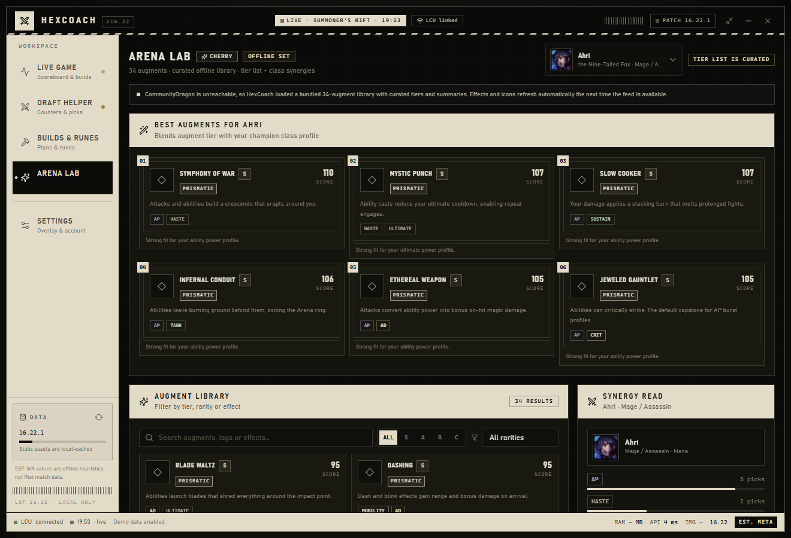

# HexCoach

A fast, lightweight League of Legends overlay coach built with **Tauri v2**, **Rust**, **React**, **TypeScript** and **Tailwind CSS**.

HexCoach reads the local Riot Live Client API and League Client API, then shows a compact always-on-top HUD with the things you actually need during a game: builds, runes, skill order, enemy threats and Arena augments.

> HexCoach isn't endorsed by Riot Games and doesn't reflect the views or opinions of Riot Games or anyone officially involved in producing or managing Riot Games properties. Riot Games and all associated properties are trademarks or registered trademarks of Riot Games, Inc.

## Screenshots

| Live game | Draft helper |
| --- | --- |
|  |  |

| Builds & runes | Arena Lab |
| --- | --- |
|  |  |

| Settings | Compact overlay |
| --- | --- |
|  |  |

## Design

The interface is a monochrome, industrial hazard-label system: warm black paper stock (`#0a0a08`), cream label bands (`#e9e2ce`), heavy condensed uppercase type, 2px corners, diagonal hazard stripes and barcode accents. Cream surfaces carry black type; data panels stay dark so champion art and item icons do the talking.

All colours come from the Tailwind theme in `tailwind.config.js` and the component classes in `src/styles.css`, so the whole app can be re-skinned from two files.

## Features

- **Live game HUD** — polls `https://127.0.0.1:2999/liveclientdata/allgamedata` every ~2 seconds, tolerates the self-signed local certificate, and detects champion, role, game mode, scoreboard, items, events and Arena augments.
- **Draft helper** — counters, synergies and estimated win-rate heuristics, plus a live champ-select mirror from the local League Client API.
- **Builds & runes** — starter, boots, core and situational items, full rune pages, shard selection and an 18-level skill order.
- **Arena Lab** — searchable augment library with tier list, rarity filters, champion-class synergy scoring and active-game augment detection. If CommunityDragon is unreachable, a bundled 34-augment curated library keeps the page useful offline.
- **One-click rune import** — writes the recommended page into the League client through the local LCU API (`127.0.0.1:<lockfile port>`). No Riot API key needed.
- **Compact overlay** — `432 × 590` always-on-top HUD with core items, runes, skill order and fed enemies.
- **Local-first data** — Data Dragon and CommunityDragon files plus images are cached per patch in the app cache directory.
- **Performance HUD** — RAM, local API latency, patch, cache size and cached image progress.
- **Global hotkeys** — compact mode, click-through and show/hide, registered by Rust.

## Stack

| Layer | Technology |
| --- | --- |
| Shell | Tauri v2 (Rust) |
| UI | React 19 + TypeScript + Tailwind CSS |
| Icons | Lucide React |
| HTTP | `reqwest` (Rust) with a separate client that accepts the local self-signed certificate |
| Static data | Data Dragon + CommunityDragon |
| Build | Vite 6 + Cargo |

## Requirements

- Windows 10/11 (the release workflow targets Windows; the code itself is portable)
- Node.js 20+ and npm
- Rust stable with the MSVC target
- Visual Studio 2022 Build Tools (Desktop development with C++)
- Microsoft Edge WebView2 runtime (preinstalled on Windows 11)

## Development

```powershell
npm install
npm run tauri:dev
```

The first launch fetches the current Data Dragon patch, rune/item/champion data and Arena augments, then warms the image cache. Later launches load from disk.

### Web preview (no Tauri shell)

```powershell
npm run dev
```

The browser preview fetches Data Dragon directly and falls back to demo live-game data, so you can iterate on the UI without the desktop shell. Rune import and real local-client polling are desktop-only.

Preview deep links are available for screenshots and UI work:

```text
http://127.0.0.1:1420/?page=live|draft|builds|arena|settings
http://127.0.0.1:1420/?compact=1
```

### Production build

```powershell
npm run tauri:build
```

Installers are written to `src-tauri/target/release/bundle/`.

### Data validation

```powershell
node scripts/validate-data.mjs
```

Validates every champion, item, rune and Arena augment name in `src/data/meta.json` against the live Data Dragon / CommunityDragon files.

## Project layout

```
src/
  components/        HUD shell, compact overlay, pickers, shared UI
  pages/             Live Game, Draft, Builds, Arena, Settings
  lib/               API wrappers, types, assets, browser fallback, demo data
  data/meta.json     curated patch data (builds, rune profiles, matchups, Arena tiers)
  data/arena-fallback.json  bundled Arena augments used when CommunityDragon is offline
src-tauri/src/
  ddragon.rs         Data Dragon patch resolution, JSON + image cache
  arena.rs           CommunityDragon Arena augments
  live_client.rs     Live Client API polling and parsing
  lcu.rs             League Client lockfile, champ select and rune import
  recommend.rs       Recommendation engine
  shortcuts.rs       Global hotkeys
  settings.rs        Local settings persistence
  commands.rs        Performance, compact mode, app info
scripts/             Data validation and publishing helpers
```

## Riot endpoints used

| Endpoint | Purpose |
| --- | --- |
| `https://127.0.0.1:2999/liveclientdata/allgamedata` | In-game state (self-signed certificate) |
| League lockfile → `/lol-champ-select/v1/session` | Champ select mirror |
| League lockfile → `/lol-perks/v1/pages` | Rune page import |
| `https://ddragon.leagueoflegends.com` | Champions, items, runes, spells and images |
| `https://raw.communitydragon.org` | Arena augment metadata and icons |

The Riot API key stored in Settings is optional and only used for future profile features. Live builds, rune import and static data never require it.

### Arena data fallback

Arena augments are fetched from CommunityDragon and cached for 12 hours. If the feed is down (it occasionally returns 502/522) or the browser preview cannot reach it because of CORS, HexCoach uses `src/data/arena-fallback.json` and labels the library **OFFLINE SET**. The live feed and icons replace it automatically once it is reachable again.

## About win rates

HexCoach labels its estimates **EST. WR**. They are derived from the curated meta scores in `src/data/meta.json` plus class heuristics — **not** from Riot match history or a live win-rate provider. Treat them as drafting guidance, not statistics.

## Releases

`.github/workflows/release.yml` builds the Windows NSIS installer with the official [`tauri-action`](https://github.com/tauri-apps/tauri-action) on every push to `main`, on `v*` tags, and on manual dispatch. The workflow creates a GitHub Release and attaches the generated `.exe` installer (plus `.msi` if you extend the bundle list).

To publish the repository for the first time:

```powershell
gh auth login
powershell -ExecutionPolicy Bypass -File scripts/publish.ps1 -Name hexcoach
```

## Settings

Settings and the Data Dragon cache live in your app config/cache directories. No telemetry, no cloud sync.

- Demo mode (default on) shows a realistic fake game so the UI is explorable without League running.
- Turn demo mode off to read the real Live Client and League Client APIs.
- Global hotkeys use Tauri accelerator syntax, e.g. `CommandOrControl+Shift+C`.

## License

MIT
